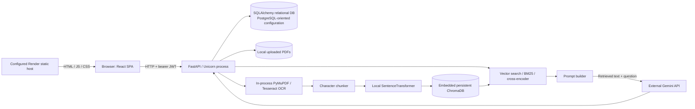

# Exam Intelligence: current high-level design

Status: Phase 2B, 2026-11-17. This describes the implementation and deployment
configuration in this checkout. Proposed work is labeled separately. See
[LLD.md](LLD.md) for contracts and [BASELINE_REPORT.md](BASELINE_REPORT.md) for evidence.

## Deployment evidence and limits

The repository contains a Render **static frontend** definition in
`frontend/exam_intelligence/render.yaml`: `npm ci && npm run build`, publish
`./dist`, configure `VITE_API_BASE_URL`, and rewrite browser routes to `index.html`.
The manifest assumes the frontend directory is the service's working directory;
the Render dashboard's actual root-directory setting was not inspected.

The backend entry point is `uvicorn app.main:app`, normally from `backend/`.
`backend/runtime.txt` declares Python 3.11.11. The test environment actually uses
Python 3.11.9. SQLAlchemy constructs its database engine from `DATABASE_URL`;
source comments, driver dependencies and setup notes target PostgreSQL. There is
no hardcoded SQLite fallback in application code. Tests deliberately use SQLite.

No backend hosting manifest, live deployment inventory, production URL, database
provider, worker count, storage mount, TLS termination configuration, or verified
live deployment status was supplied or queried. Therefore this document describes
the **actual code's runtime topology and checked-in deployment shape**, not a
claimed audit of a running production environment. Whether local storage survives
a particular hosting platform's restart is currently unverified.

## Runtime components

Parsing, embedding, keyword scoring, reranking, prompting, and embedded Chroma
access occur in the backend process. They are not separately deployed services.
The code has no job queue, distributed cache, independent vector server, or object
storage service. The local embedding model is `all-MiniLM-L6-v2`; the reranker is
`cross-encoder/ms-marco-MiniLM-L-6-v2`; answer generation uses `gemini-2.5-flash`.

## User and data flows

Registration stores a bcrypt password hash and normalized email in SQL. Login
returns an expiring JWT. The browser keeps it as `localStorage.userToken`, and an
Axios interceptor attaches it to requests. Each protected request verifies the
JWT and queries the user table. Logout deletes the browser token.

Uploading a PDF first streams it through a size-limited validation gate. The gate
uses the declared PDF MIME type, a PDF signature, and PyMuPDF parsing; it rejects
empty, malformed, encrypted, unsupported, and oversized input. The client name is
safe display metadata only. The server writes new content as
`<UPLOAD_DIR>/<document UUID>/document.pdf`, then commits a document record,
parses pages, chunks text, batches embeddings into Chroma, and commits SQL
chunk records individually. These stores do not share a transaction. A failure
can leave a document record, file, vectors, and some chunks behind.

A question is embedded and searched against Chroma with a user-ID filter. When a
document is selected, the API validates its canonical UUID and SQL ownership, and
Chroma combines that UUID with the user-ID filter. Global scope uses the user-only
filter. Up to ten vector candidates are narrowed to five by BM25, scored by hybrid
fusion, reranked, and used in one Gemini prompt. Empty retrieval returns a clear
response without calling Gemini. The response carries the answer plus source
metadata and excerpts. No previous chat turns are included in the request or prompt.

The dashboard lists the current user's documents. PDF viewing and deletion check
SQL ownership; chunk lookup checks stored ownership metadata. Deletion removes
vectors, then the PDF and its directory, then the SQL record and related SQL
chunks. Failures can leave partial deletion.

## Storage boundaries

| Store | Contents | Lifecycle |
|---|---|---|
| Relational DB | Users, document metadata, duplicate chunk text/metadata, chat tables | External connection selected by `DATABASE_URL` |
| Chroma collection `exam_intelligence` | Embeddings, passage text, owner/document/page/chunk metadata | Embedded `PersistentClient`, default `backend/chroma_db` when launched from backend |
| Filesystem | Uploaded PDF bytes under document UUID directories; new files use server name `document.pdf` | Default `uploads`, relative to working directory |
| Browser | JWT and in-memory messages | JWT persists in local storage; messages disappear on remount/reload |

`CHUNKS_DIR` is created but is not the active chunk persistence mechanism.
Chat-session and message tables exist, but the chat endpoint does not persist to
them. SQL document integer IDs and public document UUIDs are distinct. The chat
selector and vector metadata now use the public document UUID.

## Security and external data transfer

Protected routes use bearer authentication and the ownership checks described
above. Selected-document chat validates ownership before retrieval, while Chroma
also applies the authenticated user ID to both global and document-scoped search.
CORS currently permits all origins/methods/headers with credentials enabled.
PDF validation combines MIME, streamed size, signature, encryption, page-count,
and page-load checks. `MAX_PDF_UPLOAD_SIZE_BYTES` defaults to 25 MiB. Client paths,
absolute names, traversal, control characters, non-PDF suffixes, and overlong names
are rejected. Pre-database failures remove their staged server-generated path.

Embedding and reranking run locally. Retrieved passages and the user's question
are sent to Gemini. Passwords are stored as hashes; JWT signing and Gemini keys
come from environment variables. No production secrets are included in these docs.

## Operations and failure behavior

`/health/live` checks process responsiveness. `/health/ready` executes `SELECT 1`
and calls Chroma's `count()`, returning 503 if either fails. It does not probe
Gemini, OCR, parsing quality, model inference, or upload-directory writability.
Logging goes to the console at INFO level; dependency failures log exceptions.

Models, Chroma, and storage directories are initialized during module import.
The embedding module also contains an unused second loader. Multiple backend
workers would each load models; memory and multi-worker persistent-Chroma behavior
have not been measured. Upload's async handler performs synchronous disk and model
work without background processing. No throughput or latency claim is established.

The frontend has no protected-route wrapper or centralized expired-token recovery.
LLM failures become a generic answer string inside a normal chat response. Empty
retrieval returns a no-context answer without calling Gemini, and missing chunks
return 404.

## Phase 1 testing topology (not production architecture)

Tests import the real application only after `.env` loading is disabled and safe
test configuration installed. They use a new temporary SQLite database and new
in-memory Chroma collection per case, synthetic PDFs, model doubles, and blocked
outbound networking. No production stores, uploaded files, or model caches are
opened. This test topology must not be confused with the application deployment.

OCR is invoked only for pages whose extracted text is shorter than the existing
threshold. `TESSERACT_CMD` may name the executable; when unset, pytesseract resolves
`tesseract` through `PATH`. Missing Tesseract raises an error identifying the page
and both configuration choices. Text PDFs do not require the executable.

## Proposed improvements after Phase 2B: not implemented

Next repair chunk-ID consistency and recoverable ingestion/deletion. Run the strict
regressions after each repair and convert only the relevant expected failures to
normal tests. Then agree on an evaluation corpus and measure real model behavior
before changing candidate selection, ranking, chunking, or prompting. No
infrastructure expansion is proposed as a prerequisite for those fixes.
