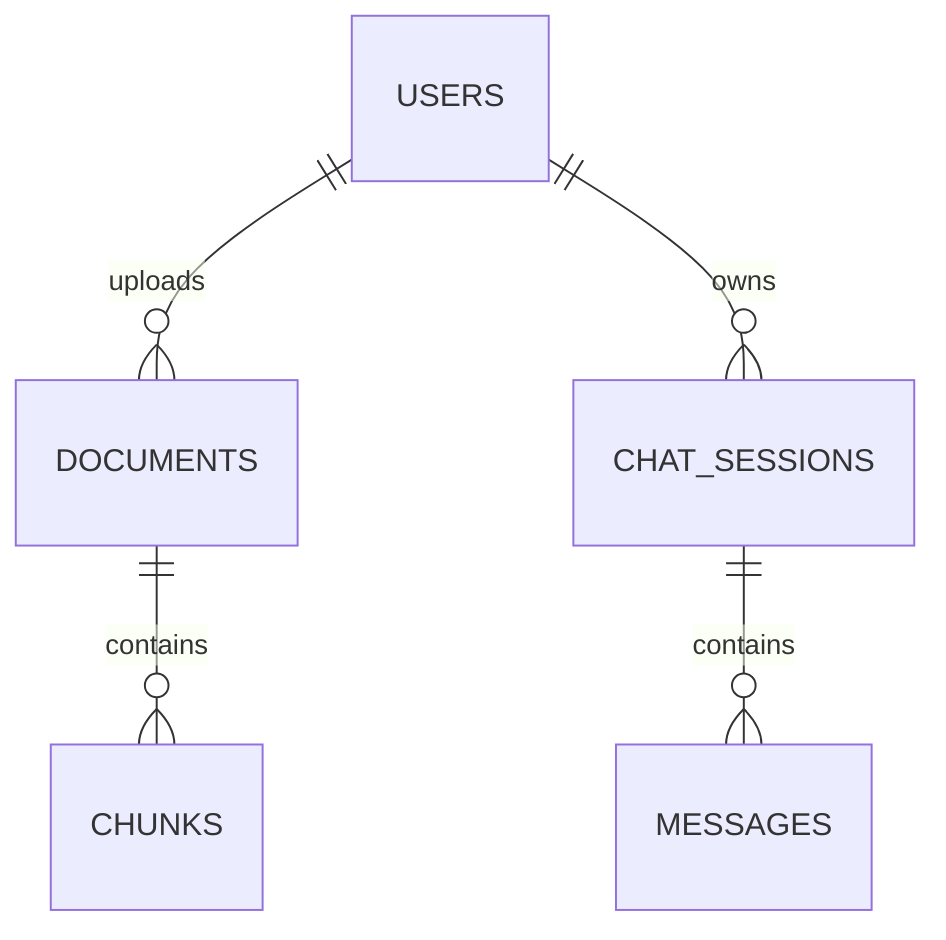

# Exam Intelligence: current low-level design

Status: Phase 4, 2026-11-18. Current behavior is authoritative here; desirable
changes are listed separately at the end. Paths below are relative to the repo.

## Assembly and module responsibilities

| Module | Current responsibility |
|---|---|
| `backend/app/main.py` | Logging, FastAPI object, wildcard CORS, router registration, informational root |
| `app/api/upload.py` | Upload, document list/view/delete, single/document chunk APIs |
| `app/api/chat.py` | Validate chat input, load current user, verify selected-document existence/ownership, call orchestration, validate output |
| `app/api/health.py` | Liveness and SQL/Chroma readiness checks |
| `app/api/documents.py` | Empty; no registered functionality |
| `app/auth/routes.py` | Signup/login database and token flow |
| `app/auth/schemas.py` | Email validation/normalization, six-character password minimum |
| `app/auth/hashing.py` | bcrypt hash/verify; input sliced to 72 characters |
| `app/auth/jwt_handler.py` | JWT `sub` and `exp`, environment-selected algorithm and expiry |
| `app/auth/dependencies.py` | Read bearer header, verify JWT, load user or return 401 |
| `app/db/database.py`, `session.py`, `base.py` | Engine, session factory, request session cleanup, declarative base |
| `app/db/models/` | Five SQLAlchemy tables and relationships |
| `app/db/crud/` | Committing user/document/chunk/chat persistence helpers |
| `app/models/chat.py` | Active `ChatRequest`, `Source`, `ChatResponse` Pydantic contracts |
| Other `app/models/`, `app/db/schemas/` | Additional schemas; mostly unused by active routes |
| `app/services/ingestion_service.py` | Parse -> chunk -> Chroma write -> SQL chunk writes |
| `app/services/chat_service.py` | Retrieve -> rerank -> prompt -> LLM -> sources |
| `app/rag/parser.py` | PyMuPDF block extraction and Tesseract fallback |
| `app/rag/chunker.py` | Recursive character splitting and metadata assignment |
| `app/rag/embedder.py` | Actual MiniLM encoder, single/batch normalized vectors |
| `app/rag/vectordb.py` | Chroma client/collection, add/query/get/delete |
| `app/rag/retriever.py` | Chroma results -> LangChain Documents -> BM25 -> hybrid scores |
| `app/rag/bm25.py`, `hybrid_search.py` | Candidate keyword scores and weighted fusion |
| `app/rag/reranker.py` | Cross-encoder pair scoring and descending sort |
| `app/rag/prompt_builder.py` | Document-first prompt with general-knowledge fallback instructions |
| `app/rag/llm_service.py` | Gemini call, text extraction, typed provider failures |
| `app/observability/performance.py` | Request-scoped timers and best-effort rotating JSONL writer |
| `backend/scripts/performance_metrics.py` | Offline validation, CSV export, grouped statistics and Markdown report |
| `app/evaluation/dataset.py` | Gold-record validation, hashing and deterministic leakage-aware splitting |
| `app/evaluation/metrics.py` | Retrieval, citation, abstention and human-score aggregation formulas |
| `app/evaluation/runner.py` | Offline production-pipeline execution and JSON/CSV/Markdown results |
| `backend/scripts/rag_evaluation.py` | Dataset validation, splitting, corpus hashing and evaluation CLI |
| `app/utils/helpers.py` | Whitespace, page-label, repeated-dot cleaning |

Frontend startup is `index.html -> src/main.jsx -> App.jsx`. `App.jsx` maps `/`
to login, `/signup` to registration, `/dashboard` to document management, `/chat`
to chat. `api/axiosInstance.js` reads `VITE_API_BASE_URL` and attaches `userToken`.
`api/apiService.js` exposes authentication, document and chat functions.

## HTTP contracts

All successful endpoints currently use HTTP 200. Body-validation errors use 422.
Protected routes require `Authorization: Bearer <JWT>`.

| Method/path | Input | Current output / notable errors |
|---|---|---|
| GET `/` | None | `{message, status: "running"}` |
| GET `/health/live` | None | `{status: "alive"}` without dependency access |
| GET `/health/ready` | None | `{status: "ready", checks: {database, vector_store}}`; 503 with `not_ready` and `unavailable` values |
| POST `/auth/auth/signup` | JSON `{name, email, password}` | `{message}`; 400 duplicate email, 422 invalid email/short password |
| POST `/auth/auth/login` | URL-encoded `username=<email>&password=...` | `{access_token, token_type: "bearer"}`; 401 invalid email/password |
| POST `/api/upload` | Multipart PDF `file` | Existing `{message, document: {id, document_uuid, filename, uploaded_by, total_pages, total_chunks}}`; 400 invalid/empty/malformed/encrypted/name, 413 oversized |
| GET `/api/documents` | Bearer token | Array of SQL document objects belonging to user |
| GET `/api/view/{document_uuid}` | UUID path parameter | PDF bytes; 404 missing record/file, 403 non-owner |
| GET `/api/chunks/{document_uuid}` | UUID path parameter | Raw Chroma get result with parallel IDs/documents/metadatas arrays; 404 missing record, 403 non-owner |
| GET `/api/chunk/{chunk_id}` | Chunk ID | `{chunk_id, text, metadata}`; 403 wrong owner; 404 missing chunk |
| DELETE `/api/delete/{document_uuid}` | UUID path parameter | Existing `{message, document_uuid}`; 404 missing, 403 non-owner, 500 incomplete cleanup/recovery required |
| POST `/api/chat` | JSON described below | `ChatResponse`; 401 authentication, 422 invalid body, 502 Gemini/provider failure |

The authentication prefix is doubled because both its APIRouter and
`main.include_router` add `/auth`. OAuth's token URL matches `auth/auth/login`.

The document list returns ORM objects without an explicit response model. Current
serialized document columns include integer `id`, UUID string `document_uuid`,
`title`, `filename`, server-side `file_path`, `subject`, integer `uploaded_by`, and
`created_at`. The unused `DocumentResponse` schema does not filter this endpoint.

```json
{
  "question": "Explain normalization",
  "top_k": 5,
  "document_id": "11111111-1111-4111-8111-111111111111"
}
```

`question` is a required string with no nonempty/length constraint. `top_k` is an
integer defaulting to 5 but is not forwarded to the service. `document_id` is an
optional canonical UUIDv4 string. Numeric, noncanonical, non-v4, and non-string
values fail request validation with 422. A UUID with no SQL document returns 404;
a document belonging to another authenticated user returns 403. The route passes
the normalized UUID string to the service only after ownership succeeds. `null` or
an omitted field selects global scope.

```json
{
  "question": "Explain normalization",
  "answer": "Generated text",
  "sources": [
    {"page": 1, "chunk_id": "chunk-uuid", "document_id": "document-uuid", "content": "Passage"}
  ]
}
```

Each source field is optional and defaults to null. Sources are the selected
context passages, not verified mappings between generated claims and evidence.

## Relational model and identifiers



| Table | Columns |
|---|---|
| `users` | `id` integer PK/index, required name, unique required email, required hashed_password, server created_at |
| `documents` | `id` integer PK/index, required title/filename/file_path, subject, unique indexed document_uuid, uploaded_by FK users.id, server created_at |
| `chunks` | `id` integer PK/index, document_id FK documents.id, chunk_index, page_number, content text, chroma_id string, chunk_metadata JSON |
| `chat_sessions` | `id` integer PK/index, user_id FK users.id, title, server created_at |
| `messages` | `id` integer PK/index, session_id FK chat_sessions.id, role, content text, server created_at |

Document->chunks has ORM `cascade="all, delete"`. Other relationships do not have
that explicit delete cascade. Chunk/document foreign keys and UUID fields are not
all declared non-null. `create_tables.py` imports models and calls `create_all`;
it is not a migration runner.

There are three different ID concepts:

1. SQL document integer ID: parent FK for relational chunk rows.
2. Document UUID string: filesystem folder, document-management API lookup, and
   Chroma metadata's `document_id`.
3. Chunk UUID: Chroma primary ID and metadata's `chunk_id`.

The chat dropdown uses `doc.document_uuid`, matching Chroma metadata and the chat
request. The chunker generates one chunk UUID. Chroma uses it as the primary ID
and metadata `chunk_id`; SQL stores the identical value in `Chunk.chroma_id`.
Page number, chunk index, document UUID, and owner metadata are unchanged.

## Upload algorithm and commit boundaries

```mermaid
sequenceDiagram
    participant UI as Dashboard
    participant API as Upload route
    participant SQL as SQL database
    participant RAG as Ingestion service
    participant CV as Chroma
    UI->>API: multipart PDF + bearer token
    API->>API: validate display name and MIME; generate UUID path
    API->>API: stream with byte limit; validate signature/pages/encryption
    API->>SQL: add document and FLUSH
    API->>RAG: path, SQL id, UUID, user id
    RAG->>RAG: parse pages, clean, chunk
    RAG->>CV: generate embeddings, add all chunks
    loop Each chunk
        RAG->>SQL: add chunk with canonical Chroma UUID and FLUSH
    end
    RAG-->>API: retained pages and chunk count
    API->>SQL: COMMIT document + all chunks once
    API-->>UI: HTTP 200 + document summary
```

`MAX_PDF_UPLOAD_SIZE_BYTES` is read from the environment and defaults to
26,214,400 bytes (25 MiB). The route reads at most the remaining allowance plus
one byte, so enforcement occurs during streaming. The client filename must be a
single relative printable name ending in `.pdf`, may be at most 255 characters,
and is retained only in SQL/display metadata. New bytes are stored at the
server-controlled `<UPLOAD_DIR>/<UUID>/document.pdf` path.

Before SQL creation, the route verifies `%PDF-`, opens the file with PyMuPDF,
rejects password-protected and zero-page documents, and loads every page. Any
pre-database error removes the staged file/directory and closes the upload stream.
Ingestion runs synchronously inside the async upload route. The document and all
chunks share one SQL transaction; CRUD helpers flush without committing on this
path. Parse, embedding, vector, SQL-write, or final-commit failure causes SQL
rollback plus best-effort deletion of document vectors and the staged PDF/folder.
Cleanup is idempotent when resources are absent. The stores have no shared atomic
transaction, so compensation failure is logged and may require operator recovery.
The `vector_write` test models an accepted write followed by failed acknowledgement.

Parsing sorts PDF blocks by `(y, x)`. Pages with fewer than 20 extracted characters
invoke OCR. Empty cleaned pages are discarded. `TESSERACT_CMD` selects an explicit
executable; otherwise pytesseract runs `tesseract` through `PATH`. Text-rich pages
never require OCR. When OCR is required and the executable is missing, the parser
raises a clear error containing the one-based page and both configuration options.
PyMuPDF documents, pixmaps, byte streams, and PIL images use bounded cleanup while
the existing one-based page metadata remains unchanged.

Cleaning collapses whitespace before splitting, removes `Page <digits>`, and
collapses repeated dots. Chunking is page-local, uses 250-character size and
50-character overlap, and tries `\n\n`, `\n`, `. `, and space boundaries. Chunks
under 30 characters are skipped. Removed whitespace reduces the available
paragraph structure. Counts describe retained pages/chunks rather than physical
page count. Chunk dictionaries contain text, generated ID, UUID, page, position,
and owner metadata.

The actual embedding model is hardcoded MiniLM despite the unused configuration
value `models/embedding-001`. Vectors are normalized. Chroma persists explicit
vectors/text with metadata `{chunk_id, document_id, user_id, page, chunk_index}`.
The SQL metadata additionally carries `document_uuid` from the chunker.

## Retrieval and generation algorithm

1. The route validates an optional canonical UUIDv4, loads the SQL document and
   verifies ownership. It forwards question, authenticated integer user ID and
   normalized UUID string; `request.top_k` is still discarded.
2. The service requests `RERANK_TOP_K=10` vector candidates. `search_chunks`
   embeds the question. Global scope uses `where={"user_id": int(user_id)}`.
   Document scope uses Chroma `$and` with that user ID and the selected document
   UUID. Both layers therefore enforce selected-document isolation.
3. The retriever constructs LangChain Documents, carrying `score=1-distance`.
   The collection has no explicitly configured distance metric in this code.
4. BM25 indexes only those candidates with whitespace tokenization; it does not
   lowercase or independently search the entire collection. Its default top five
   truncates candidates before hybrid fusion.
5. Hybrid fusion divides each score by its candidate maximum (zero maxima become
   one) and computes `0.7 * vector + 0.3 * BM25`. Weights are hardcoded rather
   than read from the matching settings constants.
6. The cross-encoder scores `(question, passage)` pairs and sorts descending.
   The service keeps up to five. Cross-encoder score determines final order;
   prior hybrid order only survives ties after candidate selection.
7. If initial retrieval is empty, or no passage remains after reranking, the
   service returns the existing `{question, answer, sources}` shape with an empty
   source list and a clear no-context answer. It does not build a prompt or call
   Gemini on this path.
8. With context, the complete prompt is built exactly once. It joins passage text,
   asks for document-first answers, allows a
   disclosed general-knowledge fallback, and instructs separate answers to
   multiple questions. Page/chunk/document metadata is not put into the prompt.
9. Gemini's synchronous `generate_content` is called once. Successful text is
   returned; empty text and exceptions become generic answer strings.
10. Selected chunks become source objects independently of the generated answer.

Phase 2A changed filtering and control flow only. It did not change retrieval
weights, models, candidate counts, chunking, BM25, hybrid scoring, reranking, or
prompt content.

## Document management and error handling

List queries filter `uploaded_by`. View/chunks/delete fetch a UUID and return 404
for no record, then 403 for an ownership mismatch. View returns 404 for a missing
file. Single-chunk lookup now returns Chroma's empty result unchanged, allowing the
route to return 404 before reading metadata. An existing chunk still checks the
stored user ID before returning text, preserving the 403 ownership behavior.

Deletion rejects non-owners before mutation and verifies that the resolved folder
is under `UPLOAD_DIR`. Unexpected files cause HTTP 500 with all three stores left
unchanged. Otherwise it snapshots document vectors, renames the folder to
`.<document UUID>.deleting`, deletes vectors, and commits SQL deletion. Failure
before that commit rolls SQL back, restores missing vectors from the snapshot, and
renames the folder back. After commit it removes the staged file/folder. Failure
there returns HTTP 500 and leaves only the staging orphan; retrying the original
UUID safely returns 404 because logical deletion completed.

| Failure | Current behavior |
|---|---|
| Missing bearer / invalid JWT / absent token user | 401 |
| Invalid request body | Framework 422 |
| Duplicate signup | 400 |
| Invalid login | 401, distinguishes email/password errors |
| Declared non-PDF, unsafe filename, empty/spoofed/corrupt/encrypted PDF | 400; pre-database staged artifact removed |
| PDF exceeds configured limit | 413; pre-database staged artifact removed |
| Missing Tesseract when OCR is required | Clear parser error naming page, `PATH`, and `TESSERACT_CMD`; text PDFs are unaffected |
| OCR / embedding / vector / SQL ingestion error | 500; SQL rollback plus document-scoped vector/filesystem compensation |
| Delete preflight or pre-commit failure | 500; existing SQL/file/vector state retained or restored |
| Delete cleanup failure after SQL commit | 500; SQL/vector deletion remains, `.deleting` folder requires recovery |
| Empty retrieval | 200 with original question, clear no-context answer and `sources: []`; no prompt or Gemini call |
| Missing chunk | 404 `Chunk not found` |
| Gemini error | Logs, returns generic answer text within 200 chat response |
| SQL or vector readiness failure | Logs and returns 503; both checks still attempted |

## Frontend behavior and Phase 1 lint repair

Dashboard reloads documents after upload/delete. PDF viewing requests a bearer-
authenticated blob and opens an object URL. Chat stores messages only in component
state, sends the current question only, and renders answer strings directly rather
than through Markdown. Source cards display page and excerpt, without a linked PDF
page or document filename. The selector stores and submits `document_uuid`; its
empty option submits `null` for global user scope. Routes have no authentication wrapper.

Before the Phase 1 repair, Dashboard's initial effect called component helper
`loadDocs`, which led to `setDocuments` and triggered the configured
`react-hooks/set-state-in-effect` rule. The initial request now starts in the
effect, with state updated in its promise callback and an unmount cleanup flag.
The existing helper still refreshes after upload/delete. The cause was recorded in
[BASELINE_REPORT.md](BASELINE_REPORT.md) before this limited edit.

## Regression mapping after Phase 2C

All cases below live in `backend/tests/regression/test_known_bugs.py`. Phase 2A
converted only the repaired cases to normal tests.

| ID | Test | Phase 2A status |
|---|---|---|
| BUG-01 | `test_document_specific_search_excludes_other_documents` | Passing: owner and requested UUID both constrain search |
| BUG-02 | `test_numeric_document_id_is_rejected_at_uuid_contract` | Passing: canonical UUIDv4 boundary rejects numeric selection; UI sends UUID |
| BUG-03 | `test_empty_retrieval_returns_a_response_without_crashing` | Passing: explicit response, empty sources, no prompt/LLM call |
| BUG-04 | `test_missing_chunk_lookup_returns_empty_results`, `test_missing_chunk_api_returns_404` | Passing: empty lookup is safe and API returns 404 |
| BUG-05 | `test_sql_chunk_ids_match_chroma_ids` | Passing: SQL and Chroma ID sets correspond exactly |
| BUG-06 | `test_failed_ingestion_removes_all_created_artifacts[stage]` | Five passing cases: no SQL, vector, or PDF artifacts remain |
| BUG-06D | `test_cleanup_failure_preserves_consistent_document_state` | Passing: preflight obstacle leaves all stores unchanged |

The Phase 2C suite reports 81 passing cases and no xfails. Additional tests cover
vector-delete restoration, safe delete retry, post-commit staging recovery, and
the read-only legacy audit. Ranking still requires representative evaluation.

## Legacy consistency audit and recovery

Run `python -m scripts.check_chunk_consistency` from `backend/` only against the
explicitly selected environment. It reports SQL/vector counts and IDs present in
only one store. It has no write or repair mode. Existing document rows, PDFs, and
legacy mismatched IDs remain readable; only direct SQL-to-Chroma ID correspondence
is unreliable until reconciled.

Before any future repair, stop writers and take coordinated PostgreSQL, Chroma,
and upload-directory backups. Review a dry-run mapping by document UUID and chunk
metadata, approve it explicitly, then use an idempotent separately reviewed tool.
Rollback means restoring all three coordinated backups; Phase 2C performs no repair.

For an orphan `.<UUID>.deleting` folder, first confirm the SQL document is absent
and Chroma has no vectors for that UUID, then remove only that exact staging folder.
If SQL still exists after a pre-commit compensation failure, restore/rename the
folder if needed, run the audit, correct the failing dependency, and retry deletion.

## Phase 3 performance boundaries

`/api/chat` and `/api/upload` use request-scoped instrumentation decorators. Each
generates a private ID and UTC timestamp, establishes a context-local event,
measures total route duration, classifies exceptions, and attempts one JSONL write
in `finally`. Lower-level functions contribute exclusive stage durations without
changing API response models or their public call signatures.

Chat stages are query embedding, Chroma query, BM25, hybrid fusion, reranking,
prompt construction, and Gemini. Ingestion stages are stream storage, PDF
validation, parsing excluding OCR, OCR, chunking, batch embedding, Chroma add,
and accumulated SQL flush/commit. Nonexecuted stages remain null. Complete schema,
privacy exclusions, formulas, and concurrency limits are documented in
[PERFORMANCE_METRICS.md](PERFORMANCE_METRICS.md).

Gemini exceptions previously became generic strings inside HTTP 200 responses.
`LLMProviderError` now classifies timeout, quota, empty-response, and other provider
failures; the chat route returns HTTP 502 with `{detail: "AI provider request failed"}`.
Successful `ChatResponse` bodies remain unchanged. This correction prevents
provider outages from being measured as successful answers.

## Phase 4 offline evaluation flow

The CLI loads a private versioned JSON dataset, validates labels, and deterministically
splits exactly 100 approved records into development, validation, and held-out sets.
It records dataset/split/corpus hashes and attempts to keep document groups within
one split. Any capacity-forced document leakage is explicit metadata.

For each selected record, the runner calls the production retriever with the labeled
document scope and isolated evaluation user, then calls the production reranker and
keeps five. Label-based metrics compare returned document/page/content against
supporting spans. It validates each returned chunk through the active Chroma lookup,
including document/page/scope/user metadata. Answer generation calls the existing
chat service only when explicitly enabled; otherwise answer and human metrics remain
null. No HTTP application route imports or invokes this evaluation runner.

Outputs include ranked per-question evidence and aggregate JSON, flattened CSV, and
Markdown. Run metadata captures Git SHA, dataset/corpus hashes, models, chunking,
candidate/final counts, fusion weights, latency, errors, and exclusions. The held-out
split is documented as prohibited for parameter tuning.
