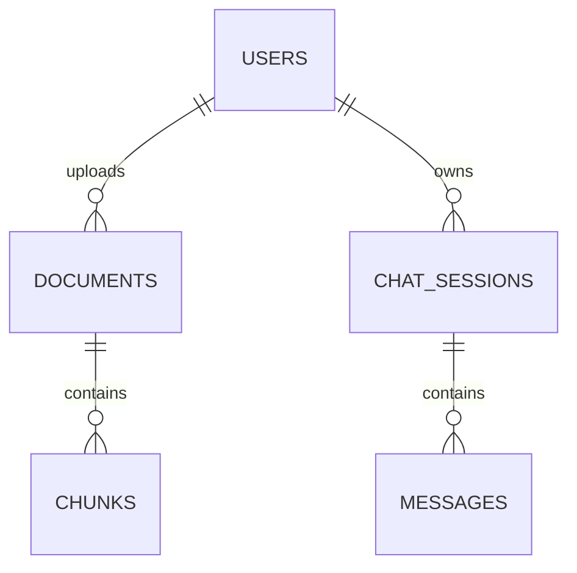
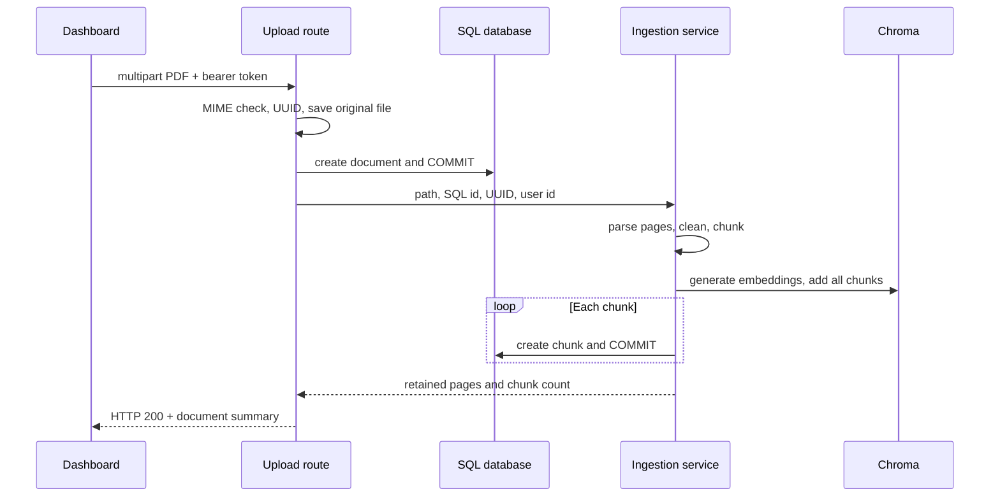

# Exam Intelligence: current low-level design

Status: Phase 1, 2026-11-17. Current behavior is authoritative here; desirable
changes are listed separately at the end. Paths below are relative to the repo.

## Assembly and module responsibilities

| Module | Current responsibility |
|---|---|
| `backend/app/main.py` | Logging, FastAPI object, wildcard CORS, router registration, informational root |
| `app/api/upload.py` | Upload, document list/view/delete, single/document chunk APIs |
| `app/api/chat.py` | Validate chat input, get current user, call orchestration, validate output |
| `app/api/health.py` | Liveness and SQL/Chroma readiness checks |
| `app/api/documents.py` | Empty; no registered functionality |
| `app/auth/routes.py` | Signup/login database and token flow |
| `app/auth/schemas.py` | Email validation/normalization, six-character password minimum |
| `app/auth/hashing.py` | bcrypt hash/verify; input sliced to 72 characters |
| `app/auth/jwt_handler.py` | JWT `sub` and `exp`, environment-selected algorithm and expiry |
| `app/auth/dependencies.py` | Read bearer header, verify JWT, load user or return 401 |
| `app/db/database.py`, `session.py`, `base.py` | Engine, session factory, request session cleanup, declarative base |
| `app/db/models/` | Five SQLAlchemy tables and relationships |
| `app/db/crud/` | Committing user/document/chunk/chat persistence helpers |
| `app/models/chat.py` | Active `ChatRequest`, `Source`, `ChatResponse` Pydantic contracts |
| Other `app/models/`, `app/db/schemas/` | Additional schemas; mostly unused by active routes |
| `app/services/ingestion_service.py` | Parse -> chunk -> Chroma write -> SQL chunk writes |
| `app/services/chat_service.py` | Retrieve -> rerank -> prompt -> LLM -> sources |
| `app/rag/parser.py` | PyMuPDF block extraction and Tesseract fallback |
| `app/rag/chunker.py` | Recursive character splitting and metadata assignment |
| `app/rag/embedder.py` | Actual MiniLM encoder, single/batch normalized vectors |
| `app/rag/vectordb.py` | Chroma client/collection, add/query/get/delete |
| `app/rag/retriever.py` | Chroma results -> LangChain Documents -> BM25 -> hybrid scores |
| `app/rag/bm25.py`, `hybrid_search.py` | Candidate keyword scores and weighted fusion |
| `app/rag/reranker.py` | Cross-encoder pair scoring and descending sort |
| `app/rag/prompt_builder.py` | Document-first prompt with general-knowledge fallback instructions |
| `app/rag/llm_service.py` | Gemini call, text extraction, generic failure response |
| `app/utils/helpers.py` | Whitespace, page-label, repeated-dot cleaning |

Frontend startup is `index.html -> src/main.jsx -> App.jsx`. `App.jsx` maps `/`
to login, `/signup` to registration, `/dashboard` to document management, `/chat`
to chat. `api/axiosInstance.js` reads `VITE_API_BASE_URL` and attaches `userToken`.
`api/apiService.js` exposes authentication, document and chat functions.

## HTTP contracts

All successful endpoints currently use HTTP 200. Body-validation errors use 422.
Protected routes require `Authorization: Bearer <JWT>`.

| Method/path | Input | Current output / notable errors |
|---|---|---|
| GET `/` | None | `{message, status: "running"}` |
| GET `/health/live` | None | `{status: "alive"}` without dependency access |
| GET `/health/ready` | None | `{status: "ready", checks: {database, vector_store}}`; 503 with `not_ready` and `unavailable` values |
| POST `/auth/auth/signup` | JSON `{name, email, password}` | `{message}`; 400 duplicate email, 422 invalid email/short password |
| POST `/auth/auth/login` | URL-encoded `username=<email>&password=...` | `{access_token, token_type: "bearer"}`; 401 invalid email/password |
| POST `/api/upload` | Multipart `file` | `{message, document: {id, document_uuid, filename, uploaded_by, total_pages, total_chunks}}`; `uploaded_by` here is email; 400 declared non-PDF |
| GET `/api/documents` | Bearer token | Array of SQL document objects belonging to user |
| GET `/api/view/{document_uuid}` | UUID path parameter | PDF bytes; 404 missing record/file, 403 non-owner |
| GET `/api/chunks/{document_uuid}` | UUID path parameter | Raw Chroma get result with parallel IDs/documents/metadatas arrays; 404 missing record, 403 non-owner |
| GET `/api/chunk/{chunk_id}` | Chunk ID | `{chunk_id, text, metadata}`; 403 wrong owner; missing chunk currently 500 before intended 404 |
| DELETE `/api/delete/{document_uuid}` | UUID path parameter | `{message, document_uuid}`; 404 missing, 403 non-owner, unhandled failures may leave partial state |
| POST `/api/chat` | JSON described below | `ChatResponse`; 401 no/invalid authentication, 422 missing required question, unhandled pipeline exceptions become 500 |

The authentication prefix is doubled because both its APIRouter and
`main.include_router` add `/auth`. OAuth's token URL matches `auth/auth/login`.

The document list returns ORM objects without an explicit response model. Current
serialized document columns include integer `id`, UUID string `document_uuid`,
`title`, `filename`, server-side `file_path`, `subject`, integer `uploaded_by`, and
`created_at`. The unused `DocumentResponse` schema does not filter this endpoint.

```json
{
  "question": "Explain normalization",
  "top_k": 5,
  "document_id": "11111111-1111-4111-8111-111111111111"
}
```

`question` is a required string with no nonempty/length constraint. `top_k` is an
integer defaulting to 5 but is not forwarded to the service. `document_id` is an
optional plain string, not UUID-validated; numeric strings are accepted.

```json
{
  "question": "Explain normalization",
  "answer": "Generated text",
  "sources": [
    {"page": 1, "chunk_id": "chunk-uuid", "document_id": "document-uuid", "content": "Passage"}
  ]
}
```

Each source field is optional and defaults to null. Sources are the selected
context passages, not verified mappings between generated claims and evidence.

## Relational model and identifiers



| Table | Columns |
|---|---|
| `users` | `id` integer PK/index, required name, unique required email, required hashed_password, server created_at |
| `documents` | `id` integer PK/index, required title/filename/file_path, subject, unique indexed document_uuid, uploaded_by FK users.id, server created_at |
| `chunks` | `id` integer PK/index, document_id FK documents.id, chunk_index, page_number, content text, chroma_id string, chunk_metadata JSON |
| `chat_sessions` | `id` integer PK/index, user_id FK users.id, title, server created_at |
| `messages` | `id` integer PK/index, session_id FK chat_sessions.id, role, content text, server created_at |

Document->chunks has ORM `cascade="all, delete"`. Other relationships do not have
that explicit delete cascade. Chunk/document foreign keys and UUID fields are not
all declared non-null. `create_tables.py` imports models and calls `create_all`;
it is not a migration runner.

There are three different ID concepts:

1. SQL document integer ID: parent FK for relational chunk rows.
2. Document UUID string: filesystem folder, document-management API lookup, and
   Chroma metadata's `document_id`.
3. Chunk UUID: Chroma primary ID and metadata's `chunk_id`.

The current chat dropdown uses `doc.id`, although Chroma uses `doc.document_uuid`.
In ingestion, SQL `chroma_id` is assigned a *new* UUID rather than the chunk UUID
already stored in Chroma. The consistency defect is engine-independent; Phase 1
reproduces the real CRUD path with SQLite, not a live PostgreSQL server.

## Upload algorithm and commit boundaries



The file's client-provided filename is directly joined to the UUID directory.
There is no configured upload-size bound or content-signature validation here.
Ingestion runs synchronously inside the async upload route. Failures are logged
and re-raised without deleting the file, rolling back earlier commits, or removing
already accepted vectors. The test `vector_write` fault deliberately models an
accepted write followed by a failed acknowledgement; it does not simulate a real
Chroma server outage.

Parsing sorts PDF blocks by `(y, x)`. Pages with fewer than 20 extracted characters
invoke OCR. Empty cleaned pages are discarded. On Windows Tesseract's executable
path is fixed to `C:\Program Files\Tesseract-OCR\tesseract.exe`.

Cleaning collapses whitespace before splitting, removes `Page <digits>`, and
collapses repeated dots. Chunking is page-local, uses 250-character size and
50-character overlap, and tries `\n\n`, `\n`, `. `, and space boundaries. Chunks
under 30 characters are skipped. Removed whitespace reduces the available
paragraph structure. Counts describe retained pages/chunks rather than physical
page count. Chunk dictionaries contain text, generated ID, UUID, page, position,
and owner metadata.

The actual embedding model is hardcoded MiniLM despite the unused configuration
value `models/embedding-001`. Vectors are normalized. Chroma persists explicit
vectors/text with metadata `{chunk_id, document_id, user_id, page, chunk_index}`.
The SQL metadata additionally carries `document_uuid` from the chunker.

## Retrieval and generation algorithm

1. The route forwards question, authenticated integer user ID and optional
   document string; `request.top_k` is discarded.
2. The service requests `RERANK_TOP_K=10` vector candidates. `search_chunks`
   embeds the question, then queries Chroma with `where={"user_id": int(user_id)}`.
   Its `document_id` argument is currently unused.
3. The retriever constructs LangChain Documents, carrying `score=1-distance`.
   The collection has no explicitly configured distance metric in this code.
4. BM25 indexes only those candidates with whitespace tokenization; it does not
   lowercase or independently search the entire collection. Its default top five
   truncates candidates before hybrid fusion.
5. Hybrid fusion divides each score by its candidate maximum (zero maxima become
   one) and computes `0.7 * vector + 0.3 * BM25`. Weights are hardcoded rather
   than read from the matching settings constants.
6. The cross-encoder scores `(question, passage)` pairs and sorts descending.
   The service keeps up to five. Cross-encoder score determines final order;
   prior hybrid order only survives ties after candidate selection.
7. Due to indentation, the complete prompt is rebuilt once per selected chunk.
   With zero chunks, `prompt` is never assigned and generation raises
   `UnboundLocalError` before any Gemini call.
8. The prompt joins passage text, asks for document-first answers, allows a
   disclosed general-knowledge fallback, and instructs separate answers to
   multiple questions. Page/chunk/document metadata is not put into the prompt.
9. Gemini's synchronous `generate_content` is called once. Successful text is
   returned; empty text and exceptions become generic answer strings.
10. Selected chunks become source objects independently of the generated answer.

No RAG algorithms, weights, models, candidate counts, or prompts changed in Phase 1.

## Document management and error handling

List queries filter `uploaded_by`. View/chunks/delete fetch a UUID and return 404
for no record, then 403 for an ownership mismatch. View returns 404 for a missing
file. Single-chunk lookup calls Chroma and indexes `metadatas[0]` before the route's
empty check, so a missing ID raises `IndexError` and an HTTP 500. An existing chunk
checks metadata's owner before returning text.

Deletion queries vector IDs and deletes them, removes the file if present, uses
`os.rmdir` for the directory, then deletes/commits the SQL record. A nonempty
directory can fail after vectors and file are gone, leaving the SQL row. There
is no retry, shared transaction, compensation, processing-status field on the
active SQL document table, or reconciliation job.

| Failure | Current behavior |
|---|---|
| Missing bearer / invalid JWT / absent token user | 401 |
| Invalid request body | Framework 422 |
| Duplicate signup | 400 |
| Invalid login | 401, distinguishes email/password errors |
| Declared non-PDF | 400 before saving anything |
| Invalid PDF / OCR / embedding / vector / SQL ingestion error | Logs and propagates; usually 500 with partial artifacts |
| Empty retrieval | UnboundLocalError -> 500 |
| Missing chunk | IndexError -> 500 |
| Gemini error | Logs, returns generic answer text within 200 chat response |
| SQL or vector readiness failure | Logs and returns 503; both checks still attempted |

## Frontend behavior and Phase 1 lint repair

Dashboard reloads documents after upload/delete. PDF viewing requests a bearer-
authenticated blob and opens an object URL. Chat stores messages only in component
state, sends the current question only, and renders answer strings directly rather
than through Markdown. Source cards display page and excerpt, without a linked PDF
page or document filename. Routes have no authentication wrapper.

Before the Phase 1 repair, Dashboard's initial effect called component helper
`loadDocs`, which led to `setDocuments` and triggered the configured
`react-hooks/set-state-in-effect` rule. The initial request now starts in the
effect, with state updated in its promise callback and an unmount cleanup flag.
The existing helper still refreshes after upload/delete. The cause was recorded in
[BASELINE_REPORT.md](BASELINE_REPORT.md) before this limited edit.

## Regression mapping and proposed Phase 2 behavior

All cases below live in `backend/tests/regression/test_known_bugs.py` and are
strict expected failures while the current bugs remain.

| ID | Test | Proposed invariant (not implemented) |
|---|---|---|
| BUG-01 | `test_document_specific_search_excludes_other_documents` | Both owner and requested UUID constrain search |
| BUG-02 | `test_numeric_document_id_is_rejected_at_uuid_contract` | Canonical UUID boundary rejects numeric selection; UI must send UUID |
| BUG-03 | `test_empty_retrieval_returns_a_response_without_crashing` | Explicit non-crashing empty-result response |
| BUG-04 | `test_missing_chunk_lookup_returns_empty_results`, `test_missing_chunk_api_returns_404` | Empty lookup is safe; route returns 404 |
| BUG-05 | `test_sql_chunk_ids_match_chroma_ids` | SQL stores the chunk's actual Chroma ID |
| BUG-06 | `test_failed_ingestion_removes_all_created_artifacts[stage]` | New failed uploads leave no orphan artifacts |
| BUG-06D | `test_cleanup_failure_preserves_consistent_document_state` | A cleanup failure does not leave contradictory stores |

The empty-response wording and recovery design are Phase 2 choices. Strict UUID
validation is a proposed contract, not an existing one. Existing characterization
tests intentionally record current permissive behavior and must be revised along
with approved repairs. Ranking improvements require a separate measured evaluation.
